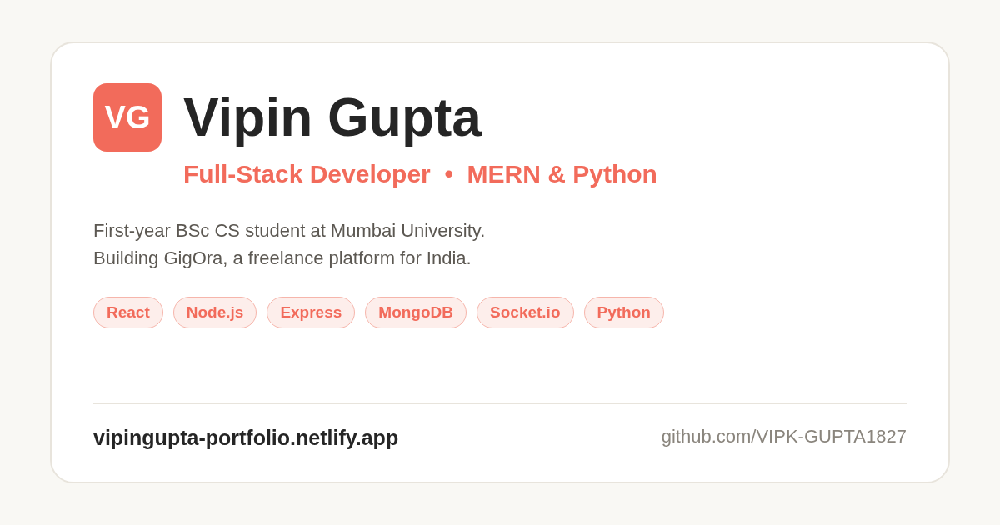

# Vipin Gupta — Portfolio

My personal portfolio site. Live: **https://vipingupta-portfolio.netlify.app/**



I'm a self-taught full-stack developer (MERN & Python) from Mumbai. I started coding about 2 years ago. This site shows the projects I've built so far.

## What's on the site

- **GigOra** – my main project, a freelance gig platform (React, Node/Express, MongoDB)
- **ResumePro**, **BillCraft** and a Python **trading bot** (testnet only)
- 4 website concepts for local businesses
- Skills, education, and a contact form

## Built with

- HTML, CSS and vanilla JavaScript (no framework, no build step)
- [Web3Forms](https://web3forms.com) for the contact form
- Font Awesome icons, Google Fonts (Barlow)
- Hosted on Netlify

## Security & Performance

- **Subresource Integrity (SRI)** with SHA-512 hashes for CDN dependencies
- **Hardened HTTP Headers** (HSTS preload, strict CSP, COOP/CORP) via Netlify `_headers`
- **RFC 9116 Vulnerability Disclosure Policy** at `/.well-known/security.txt`
- Client-side XSS input sanitization on contact form

## Run it locally

No install needed. Clone the repo and open `index.html` in your browser:

```bash
git clone https://github.com/VIPK-GUPTA1827/portfolio.git
cd portfolio
```

Or use the VS Code "Live Server" extension.

## Folder structure

```
index.html      main page
style.css       styles
script.js       mobile menu, typing effect, scroll animations, contact form
images/         project screenshots + my photo (WebP)
resume/         resume page
_headers        Netlify security headers
security.txt    RFC 9116 security disclosure policy
```

## Contact

- Email: vipingupta.dev@outlook.com
- LinkedIn: https://www.linkedin.com/in/vipin-gupta-v2718
- GitHub: https://github.com/VIPK-GUPTA1827
- Fiverr: https://fiverr.com/users/vipk_1827

© 2026 Vipin Gupta
