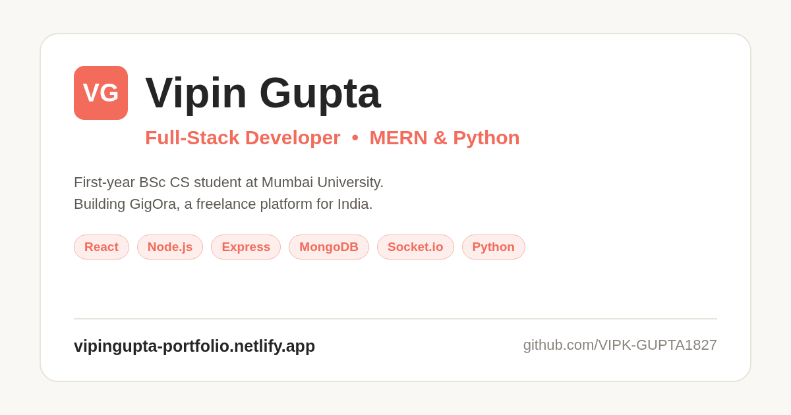

# Vipin Gupta — Portfolio

My personal portfolio site. Live: **https://vipingupta-portfolio.netlify.app/**



I'm a self-taught full-stack developer (MERN & Python) from Mumbai. I started coding about 2 years ago. This site shows the projects I've built so far.

## What's on the site

- **IndGig (IG)** – my main project, a freelance platform prototype for India (React 19, Node/Express, MongoDB, Socket.io, Tailwind CSS)
- **ResumePro**, **BillCraft** and a Python **trading bot** (testnet only)
- 4 website concepts for businesses (Vortex Digital, Studio Zero, Starry HK Cafe, Tiger Fitness)
- Skills, learning timeline, interactive resume, and a contact form

## Built with

- Semantic HTML5, modern CSS3 and vanilla JavaScript (no framework, no build step)
- [Web3Forms](https://web3forms.com) API for the contact form
- Font Awesome icons, Google Fonts (Figtree)
- Hosted on Netlify

## How I built this & AI Transparency

- **Written by me:** Core semantic HTML structure, contact form submission handling & validation logic, mobile menu toggle, scroll progress & active nav tracking, responsive layout adaptations.
- **Built with AI assistance (Claude / AI tools):** Design iterations, butter & sage green colour palette balancing, CSS modernisations, copy clarity and review audits.
- **Things I can explain:** How Web3Forms submits asynchronously, how the contact cooldown & honeypot spam traps work, how IntersectionObserver powers smooth entrance animations, and how Netlify security headers protect the site.

## Security & Performance

- **Subresource Integrity (SRI)** with SHA-512 hashes for CDN dependencies
- **Hardened HTTP Headers** (HSTS preload, strict CSP, COOP/CORP) via Netlify `_headers`
- **RFC 9116 Vulnerability Disclosure Policy** at `/.well-known/security.txt`
- Client-side form validation, honeypot spam protection, and safe localStorage handling

## Run it locally

No install needed. Clone the repo and open `index.html` in your browser:

```bash
git clone https://github.com/VIPK-GUPTA1827/portfolio.git
cd portfolio
```

Or use the VS Code "Live Server" extension.

## Folder structure

```
index.html      main portfolio page
style.css       design system & responsive styling
script.js       mobile menu, typing effect, scroll animations, contact form
404.html        custom 404 error page
images/         optimized project screenshots + photo (WebP)
resume/         ATS-friendly interactive web resume
llms.txt        machine-readable summary for AI & search indexing
robots.txt      search engine crawler directives
sitemap.xml     SEO sitemap index
_headers        Netlify hardened security headers
security.txt    RFC 9116 security disclosure policy
```

## Contact

- Email: vipingupta.dev@outlook.com
- LinkedIn: https://www.linkedin.com/in/vipin-gupta-v2718
- GitHub: https://github.com/VIPK-GUPTA1827
- Fiverr: https://fiverr.com/users/vipk_1827
